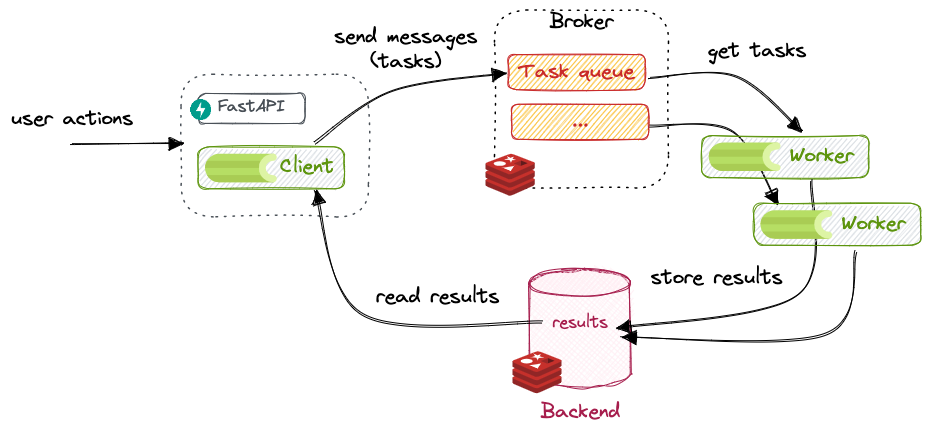
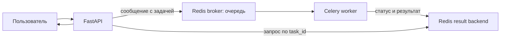

# Celery и Redis — фоновые задачи

Celery помогает выполнять долгую работу отдельно от HTTP-запроса. Например, сервер может запустить обработку видео, быстро вернуть клиенту ID задачи, а результат пользователь проверит позже.

В этом конспекте разобраны Redis, очередь задач, Celery worker, задача `add`, прогресс `save_video` и пример подключения к FastAPI.

## Как устроена работа



На схеме:

1. **FastAPI** получает запрос пользователя.
2. **Celery client** отправляет сообщение о задаче в **broker**.
3. **Redis broker** держит очередь сообщений.
4. **Celery worker** получает задачу и выполняет её в фоне.
5. Worker сохраняет состояние и результат в **result backend**.
6. FastAPI по ID задачи читает статус или готовый результат.

Для простого проекта Redis может выполнять обе роли — брокера и result backend. Это отдельные функции, даже если сервер Redis один.



## Redis: брокер и хранилище результата

- **Broker** — посредник и очередь сообщений: Celery кладёт туда задачу, worker забирает её.
- **Result backend** — место, куда Celery записывает состояние задачи и результат её выполнения.
- **Redis** — быстрое хранилище данных в памяти, которое Celery умеет использовать для обеих ролей.

Очередь не исполняет Python-функции. Она только передаёт сообщение с именем задачи и её аргументами worker-процессу.

## Установка и запуск Redis

Установить Celery с поддержкой Redis:

```bash
pip install "celery[redis]" fastapi uvicorn
```

Для локальной разработки запустить Redis в Docker:

```bash
docker run -d --name backend-redis -p 6379:6379 redis
```

Строка `redis://localhost:6379/0` означает подключение к Redis на этой же машине, порт `6379`, база Redis с номером `0`.

## Настройка приложения Celery

Пример структуры:

```text
project/
└── app/
    ├── __init__.py
    ├── celery_conn.py
    ├── tasks.py
    └── main.py
```

`app/celery_conn.py`:

```python
from celery import Celery

app = Celery(
    "backend",
    broker="redis://localhost:6379/0",
    backend="redis://localhost:6379/1",
    include=["app.tasks"],
)

app.conf.update(
    task_track_started=True,
    result_expires=3600,
)
```

- `broker` — Redis, куда отправляются новые задачи.
- `backend` — Redis, где хранятся статусы и результаты. Здесь выбрана база `1`, чтобы отделить результаты от очереди.
- `include` — модуль, в котором находятся функции задач и который нужно загрузить worker-у.
- `task_track_started=True` — Celery будет записывать состояние `STARTED` после начала выполнения.
- `result_expires=3600` — результаты хранятся ограниченное время, здесь один час.

В настоящем проекте адрес и пароль Redis лучше хранить в переменных окружения, а не записывать секреты в код.

## Простая задача `add`

`app/tasks.py`:

```python
import time
from .celery_conn import app


@app.task
def add(a: int, b: int) -> int:
    time.sleep(5)  # изображаем долгую работу
    return a + b
```

`@app.task` регистрирует функцию в Celery. Вызов `add(2, 3)` выполняет функцию как обычный Python-код, а `add.delay(2, 3)` отправляет её в очередь для worker-а.

```python
task = add.delay(2, 3)
print(task.id)  # ID, по которому позже проверим задачу
```

Задача не обязана вернуть значение сразу. `delay()` обычно быстро возвращает объект результата с ID, пока worker выполняет `sleep` и вычисляет сумму.

## Задача с прогрессом: `bind=True`

```python
@app.task(bind=True)
def save_video(self) -> str:
    for i in range(100):
        time.sleep(1)  # здесь может сохраняться очередная часть видео
        self.update_state(
            state="PROGRESS",
            meta={"percent": i + 1},
        )

    return "done"
```

- `bind=True` передаёт объект задачи первым аргументом. Здесь это `self`.
- `self.update_state(...)` сохраняет пользовательский статус и данные о прогрессе.
- `state="PROGRESS"` — собственное состояние, которое можно показывать клиенту.
- `meta={"percent": i + 1}` — данные прогресса. После очередного шага значение идёт от `1` до `100`.
- `return "done"` — финальное значение задачи. После успешного завершения Celery выставляет состояние `SUCCESS`.

Для настоящей обработки видео вместо цикла со `sleep` выполняется реальная работа. Если работа состоит из отдельных этапов, прогресс лучше вычислять по завершённым этапам.

Для записи прогресса нужен настроенный result backend. Именно его опрашивает приложение, чтобы прочитать `PROGRESS` и `percent`.

## Запустить worker

В первом терминале запусти Redis. Во втором — Celery worker:

```bash
celery -A app.celery_conn:app worker --loglevel=INFO
```

Worker должен импортировать то же приложение Celery и задачи, что использует FastAPI. Для простоты этот пример рассчитан на запуск worker-а в Linux, WSL или контейнере; Celery официально не поддерживает Windows как production-платформу.

## Запустить несколько workers

Есть два способа увеличить число одновременно выполняемых задач:

1. Увеличить число процессов внутри одного worker-а с помощью `--concurrency`.
2. Запустить несколько отдельных worker-процессов. У каждого должно быть своё имя.

Например, запусти в двух отдельных терминалах:

```bash
celery -A app.celery_conn:app worker --loglevel=INFO --concurrency=2 --hostname=worker1@%h
```

```bash
celery -A app.celery_conn:app worker --loglevel=INFO --concurrency=2 --hostname=worker2@%h
```

Оба worker-а подключатся к одной очереди Redis и будут брать из неё задачи. У каждого по два процесса для выполнения, значит вместе они могут выполнять до четырёх задач одновременно. Имена должны быть разными, иначе Celery не сможет различать workers.

Для первого запуска можно начать с одного worker-а и `--concurrency=2`:

```bash
celery -A app.celery_conn:app worker --loglevel=INFO --concurrency=2
```

`--concurrency` по умолчанию обычно равен числу CPU-ядер. Для коротких задач, которые в основном ждут сеть или диск, число можно увеличить. Для задач, которые долго считают, начинай примерно с числа ядер и проверяй нагрузку. Каждый дополнительный процесс использует память.

Запуск нескольких workers в разных терминалах удобен для обучения. На сервере их обычно запускают как отдельные службы или контейнеры, чтобы они автоматически перезапускались после сбоя.

## Flower — веб-монитор Celery

Flower показывает состояние workers и задач в браузере: какие workers подключены, что выполняется сейчас, сколько задач завершилось и какие ошибки случились.

Установка:

```bash
pip install flower
```

Запусти Flower отдельно от Redis, FastAPI и workers:

```bash
celery -A app.celery_conn:app flower --port=5555
```

Открой в браузере [http://localhost:5555](http://localhost:5555). Flower использует настройки Celery-приложения и подключается к тому же broker. В интерфейсе должны отображаться оба worker-а с разными именами.

Для локальной разработки этого достаточно. Не выставляй Flower открыто в интернет без защиты: панель позволяет видеть задачи и управлять workers. Можно включить Basic Auth:

```bash
celery -A app.celery_conn:app flower --port=5555 --basic-auth=ИМЯ:СЛОЖНЫЙ_ПАРОЛЬ
```

Используй свой пароль и храни его в настройках окружения, а не в Git.

## Отправка задачи из FastAPI

`app/main.py`:

```python
from celery.result import AsyncResult
from fastapi import FastAPI, HTTPException

from .celery_conn import app as celery_app
from .tasks import add, save_video

api = FastAPI()


@api.post("/tasks/add")
def start_add(a: int, b: int):
    task = add.delay(a, b)
    return {"task_id": task.id}


@api.post("/tasks/video")
def start_video():
    task = save_video.delay()
    return {"task_id": task.id}


@api.get("/tasks/{task_id}")
def get_task(task_id: str):
    task = AsyncResult(task_id, app=celery_app)

    response = {"task_id": task.id, "state": task.state}

    if task.state == "PROGRESS":
        response["progress"] = task.info
    elif task.state == "SUCCESS":
        response["result"] = task.result
    elif task.state == "FAILURE":
        response["error"] = str(task.info)

    return response
```

Запустить FastAPI:

```bash
uvicorn app.main:api --reload
```

Порядок работы:

1. Клиент отправляет `POST /tasks/video`.
2. FastAPI ставит `save_video` в очередь и отвечает `{"task_id": "..."}`.
3. Клиент периодически вызывает `GET /tasks/{task_id}`.
4. Пока задача работает, ответ может содержать `{"state": "PROGRESS", "progress": {"percent": 35}}`.
5. Когда задача завершится, клиент получит `{"state": "SUCCESS", "result": "done"}`.

Ответы содержат только состояние, которое FastAPI прочитал в момент запроса. Для обновления прогресс-бара клиент может опрашивать endpoint снова через некоторый интервал.

## Состояния задачи

| Состояние | Значение |
| --- | --- |
| `PENDING` | задача ожидает или Celery пока не видит её состояние |
| `STARTED` | worker начал выполнение; включается `task_track_started` |
| `PROGRESS` | пользовательское состояние, выставленное `update_state` |
| `SUCCESS` | задача завершилась успешно |
| `FAILURE` | во время задачи возникла ошибка |
| `REVOKED` | задача была отменена до выполнения или во время него |

`PENDING` не всегда означает, что задача точно стоит в очереди: Celery также может показать его для неизвестного ID или состояния, которое ещё не записано.

## Почему нельзя ждать `.get()` в HTTP-обработчике

```python
result = add.delay(2, 3)
value = result.get(timeout=10)  # не делай так в обычном async API
```

`get()` ждёт завершения задачи. Тогда HTTP-запрос снова становится долгим, и смысл фонового выполнения пропадает. Обычно endpoint возвращает `task_id`, а отдельный запрос проверяет состояние.

Результаты занимают место в backend. Не храни их бесконечно и не сохраняй тяжёлые файлы целиком как результат задачи: лучше сохранить файл в объектное хранилище или на диск и вернуть путь/идентификатор.

## Важные правила

- Worker должен работать постоянно и иметь доступ к Redis.
- Все аргументы задачи должны сериализоваться. Обычно передают простые значения: строки, числа, списки и словари.
- В очередь кладут данные и ID файлов, а не большие видео или изображения целиком.
- Задача может выполниться с задержкой или быть повторена после сбоя, поэтому обработку важных операций проектируют с учётом повторного запуска.
- Не отправляй пароли, токены и другие секреты в аргументах задач.
- Результат доступен только если задан backend. Без него Celery всё ещё может передавать и выполнять задачи, но приложение не сможет обычным способом прочитать их результат и прогресс.

## Коротко

FastAPI ставит задачу в Celery и сразу получает `task_id`. Redis передаёт задачу worker-у как брокер, worker выполняет код, а backend хранит состояние и результат. `bind=True` даёт задаче `self`, а `self.update_state()` позволяет сообщать прогресс.

## Документация

- [Введение в Celery](https://docs.celeryq.dev/en/stable/getting-started/introduction.html)
- [Celery с Redis](https://docs.celeryq.dev/en/stable/getting-started/backends-and-brokers/redis.html)
- [Задачи и пользовательские состояния](https://docs.celeryq.dev/en/stable/userguide/tasks.html)
- [Запуск и настройка workers](https://docs.celeryq.dev/en/stable/userguide/workers.html)
- [Flower — установка и запуск](https://flower.readthedocs.io/en/latest/install.html)
- [Защита Flower паролем](https://flower.readthedocs.io/en/latest/auth.html)
