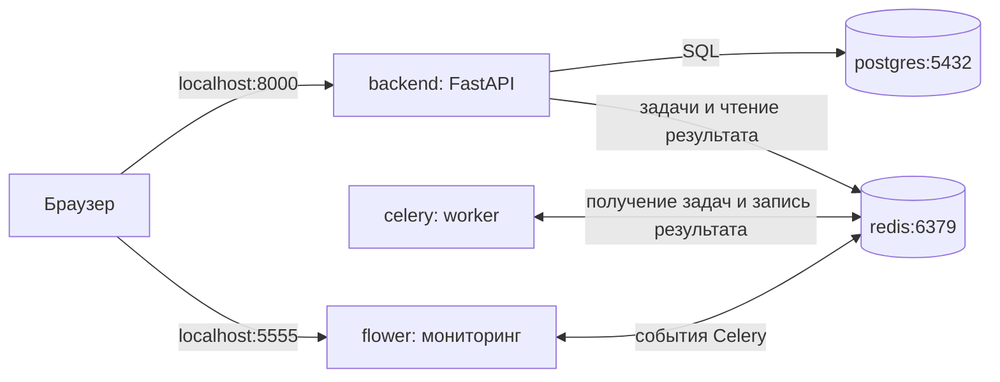

# Docker Compose — запуск backend и сервисов

Docker Compose позволяет описать весь проект в `compose.yaml` и запустить его одной командой. Здесь пять сервисов: FastAPI, Redis, Celery, Flower и PostgreSQL.

Готовые файлы: [примеры/docker-compose](<примеры/docker-compose/>). Пример предназначен для локального обучения. На Windows нужен запущенный Docker Desktop в режиме Linux-контейнеров.

## Кто что делает

| Сервис | Задача |
| --- | --- |
| `backend` | FastAPI принимает HTTP-запросы |
| `postgres` | PostgreSQL хранит данные приложения |
| `redis` | Очередь Celery и хранилище результатов задач |
| `celery` | Worker выполняет `add` и `save_video` |
| `flower` | Показывает workers и задачи в браузере |



PostgreSQL в примере подключён к FastAPI: запрос `/health/db` выполняет в базе `SELECT 1`. Таблицы пользователей можно добавить позже. Celery использует уже знакомые задачи сложения и прогресса видео.

## Файлы проекта

```text
примеры/docker-compose/
├── compose.yaml
├── Dockerfile
├── requirements.txt
├── .env.example
├── .gitignore
├── .dockerignore
└── app/
    ├── __init__.py
    ├── main.py
    ├── db.py
    ├── celery_conn.py
    └── tasks.py
```

`Dockerfile` собирает общий Python-образ для backend, worker-а и Flower. Redis и PostgreSQL используют готовые образы.

## Подготовить настройки

Открой терминал в папке `примеры/docker-compose`. При первом запуске создай `.env` из `.env.example`.

В PowerShell:

```powershell
Copy-Item .env.example .env
```

В Linux или WSL:

```bash
cp .env.example .env
```

Содержимое учебного `.env`:

```dotenv
POSTGRES_DB=backend
POSTGRES_USER=app
POSTGRES_PASSWORD=local-study-password
```

Это имя базы, имя пользователя и учебный пароль. `.env` исключён из Git и образа Docker. Поле `env_file` ниже передаёт его значения контейнеру; само наличие `.env` не передаёт все переменные в каждый контейнер.

## Полный `compose.yaml`

```yaml
name: backend-study

services:
  backend:
    build: .
    image: backend-study:local
    env_file:
      - .env
    environment:
      POSTGRES_HOST: postgres
      POSTGRES_PORT: "5432"
      CELERY_BROKER_URL: redis://redis:6379/0
      CELERY_RESULT_BACKEND: redis://redis:6379/1
    ports:
      - "127.0.0.1:8000:8000"
    depends_on:
      postgres:
        condition: service_healthy
      redis:
        condition: service_healthy

  redis:
    image: redis:7-alpine
    command: ["redis-server", "--appendonly", "yes"]
    volumes:
      - redis_data:/data
    healthcheck:
      test: ["CMD", "redis-cli", "ping"]
      interval: 5s
      timeout: 3s
      retries: 10

  celery:
    build: .
    image: backend-study:local
    command: ["celery", "-A", "app.celery_conn:app", "worker", "--loglevel=INFO", "--concurrency=2", "--hostname=worker@%h", "-E"]
    environment:
      CELERY_BROKER_URL: redis://redis:6379/0
      CELERY_RESULT_BACKEND: redis://redis:6379/1
    depends_on:
      redis:
        condition: service_healthy
    stop_grace_period: 2m

  flower:
    build: .
    image: backend-study:local
    command: ["celery", "-A", "app.celery_conn:app", "flower", "--address=0.0.0.0", "--port=5555"]
    environment:
      CELERY_BROKER_URL: redis://redis:6379/0
      CELERY_RESULT_BACKEND: redis://redis:6379/1
    ports:
      - "127.0.0.1:5555:5555"
    depends_on:
      redis:
        condition: service_healthy

  postgres:
    image: postgres:17-alpine
    env_file:
      - .env
    volumes:
      - postgres_data:/var/lib/postgresql/data
    healthcheck:
      test: ["CMD-SHELL", "pg_isready -U \"$${POSTGRES_USER}\" -d \"$${POSTGRES_DB}\""]
      interval: 5s
      timeout: 3s
      retries: 10
      start_period: 10s

volumes:
  postgres_data:
  redis_data:
```

В современных файлах Compose поле `version` не требуется. `name` задаёт имя проекта, чтобы его контейнеры и volumes были собраны в одну группу.

## Разобрать настройки

| Поле | Что означает |
| --- | --- |
| `services` | Сервисы проекта |
| `build: .` | Собирать образ по Dockerfile из текущей папки |
| `image` | Имя готового или собираемого образа |
| `command` | Команда, которую контейнер выполнит вместо `CMD` |
| `environment` | Переменные окружения внутри контейнера |
| `ports` | Порты для доступа с компьютера |
| `volumes` | Подключённые хранилища данных |
| `healthcheck` | Команда для проверки готовности сервиса |
| `depends_on` | Зависимости при запуске |

Здесь backend ожидает успешные проверки Redis и PostgreSQL благодаря `condition: service_healthy`. Обычный короткий `depends_on` сам по себе не гарантирует, что база уже принимает запросы. Эти проверки помогают при старте; приложение всё равно должно обрабатывать сбои соединений во время работы.

`$${POSTGRES_USER}` оставляет переменную для оболочки внутри контейнера. Двойной `$` не даёт Compose подставить значение раньше времени.

## Почему `redis`, а не `localhost`

Внутри контейнера `localhost` указывает на этот же контейнер.

Compose создаёт общую сеть. Сервисы находят друг друга по именам из YAML:

| Кто подключается | Адрес |
| --- | --- |
| Браузер на компьютере → FastAPI | `http://localhost:8000` |
| Браузер на компьютере → Flower | `http://localhost:5555` |
| FastAPI / Celery / Flower → Redis | `redis://redis:6379/0` |
| FastAPI → PostgreSQL | `postgres:5432` |

У Redis и PostgreSQL нет `ports`, потому что в этом примере к ним обращаются другие контейнеры. Общение внутри сети Compose не требует публикации портов на компьютер.

В [celery_conn.py](<примеры/docker-compose/app/celery_conn.py>) приложение читает адреса из окружения:

```python
app = Celery(
    "backend",
    broker=os.environ["CELERY_BROKER_URL"],
    backend=os.environ["CELERY_RESULT_BACKEND"],
    include=["app.tasks"],
)
```

`/0` и `/1` — логические базы одного Redis. В первой очередь, во второй результаты. Подключение PostgreSQL в [db.py](<примеры/docker-compose/app/db.py>) также собирается из переменных окружения.

## Запустить весь проект

Из папки с `compose.yaml`, после создания `.env`:

```bash
docker compose config --quiet
docker compose up -d --build
docker compose ps
```

Первая команда проверяет конфигурацию. Вторая собирает образ, скачивает нужные образы и запускает сервисы. `-d` освобождает терминал.

Открой:

- [FastAPI Swagger](http://localhost:8000/docs) — отправлять запросы.
- [Проверка PostgreSQL](http://localhost:8000/health/db) — ожидается `{"database": "ok"}`.
- [Flower](http://localhost:5555) — смотреть задачи и workers.

В Swagger вызови `POST /tasks/add` с `a=2` и `b=3`. Скопируй `task_id` в `GET /tasks/{task_id}`. После выполнения получишь `SUCCESS` и результат `5`. `POST /tasks/video` запускает пример с прогрессом.

Прогресс `percent` читай через API. `update_state()` пишет метаданные в result backend; Flower наблюдает события Celery, поэтому отдельный прогресс-бар автоматически из этого поля не возникает.

## Несколько Celery workers

```bash
docker compose up -d --scale celery=3
```

Будет три контейнера сервиса `celery`. У каждого `--concurrency=2`: суммарно до шести выполняющихся задач. Одна задача `save_video` при этом остаётся одной задачей.

`%h` в `worker@%h` подставляет hostname контейнера, поэтому workers получают разные имена. `container_name` не указан: фиксированное имя помешало бы создать несколько экземпляров сервиса.

Флаг `-E` включает события задач для Flower. В панели появятся workers по мере подключения.

Вернуться к одному:

```bash
docker compose up -d --scale celery=1
```

При пересборке трёх workers тоже указывай `--scale celery=3`, если нужно сохранить это количество. `stop_grace_period: 2m` даёт worker-у до двух минут на завершение текущей задачи перед принудительной остановкой.

## Логи и команды внутри

```bash
docker compose logs --tail 50 backend celery
docker compose logs -f celery
docker compose exec redis redis-cli ping
docker compose exec postgres psql -U app -d backend -c "SELECT 1;"
docker compose exec backend sh
```

`app` и `backend` в команде `psql` — значения из учебного `.env`. Если поменял их, поменяй и команду.

## Данные PostgreSQL и Redis

`postgres_data` сохраняет файлы базы. Для выбранного образа **PostgreSQL 17** используется `/var/lib/postgresql/data`. В образах PostgreSQL 18+ расположение изменено; перед сменой основной версии нужно проверить инструкцию образа и спланировать перенос базы.

Redis пишет AOF в `redis_data`. Это позволяет хранить данные между пересозданиями контейнера, но сохранность после сбоев зависит и от настроек Redis.

Переменные `POSTGRES_USER`, `POSTGRES_PASSWORD` и `POSTGRES_DB` используются для инициализации пустого каталога базы. Изменение `.env` не меняет пароль уже созданного пользователя PostgreSQL.

## Обновить и остановить

После изменений Python-кода:

```bash
docker compose up -d --build
```

Остановить сервисы, сохранив контейнеры:

```bash
docker compose stop
```

Убрать контейнеры и сеть, сохранив именованные volumes:

```bash
docker compose down
```

`docker compose down -v` дополнительно удаляет volumes проекта, включая базу и данные Redis. Это команда для полного сброса учебного проекта, когда данные больше не нужны.

## Частые проблемы

| Что произошло | Что проверить |
| --- | --- |
| Docker не отвечает | Запущен ли Docker Desktop |
| Нет файла `.env` | Создан ли он из `.env.example` |
| Порт `8000` занят | Например, поменять публикацию на `127.0.0.1:8001:8000` и открыть порт `8001` |
| Backend не видит Redis | Внутри Docker адрес должен содержать `redis`, а не `localhost` |
| Изменения кода не появились | Пересобран ли образ через `up -d --build` |
| Задача долго в `PENDING` | Запущен ли worker, совпадают ли Redis URL, что написано в логах |
| База не принимает новый пароль | Существующая база не обновляет пароль из `.env` автоматически |

Для локального примера API и Flower опубликованы только на `127.0.0.1`. Настройка публичного сервера потребует отдельной защиты доступа и секретов.

## Документация

- [Сеть Compose](https://docs.docker.com/compose/how-tos/networking/)
- [Порядок запуска и healthcheck](https://docs.docker.com/compose/how-tos/startup-order/)
- [Переменные окружения](https://docs.docker.com/compose/how-tos/environment-variables/set-environment-variables/)
- [Запуск и масштабирование](https://docs.docker.com/reference/cli/docker/compose/up/)
- [Официальный образ PostgreSQL](https://hub.docker.com/_/postgres)
- [Workers Celery](https://docs.celeryq.dev/en/stable/userguide/workers.html)
- [Запуск Flower](https://flower.readthedocs.io/en/latest/install.html)
