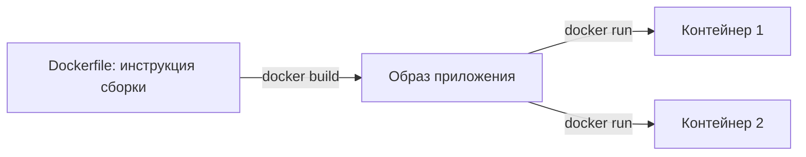

# Docker — теория

Docker запускает программу вместе с нужным окружением: Python, библиотеками и настройками. Например, для backend можно подготовить окружение один раз и запускать его на разных компьютерах.

## Образ и контейнер

**Образ (image)** — готовый шаблон: файлы приложения, зависимости и команда запуска.

**Контейнер (container)** — экземпляр приложения, созданный из образа. Из одного образа можно запустить несколько контейнеров.

Представь ресторан: образ — подготовленный набор кухни и оборудования, контейнер — работающая кухня с этим набором. Можно открыть несколько одинаково оборудованных кухонь.



Образ хранится слоями, доступными только для чтения. При запуске контейнер получает собственный слой для изменений. Остановка контейнера сохраняет этот слой, а удаление контейнера убирает его.

## Что находится внутри

У контейнера свои процессы, файловая система и сетевое окружение. Контейнеры используют ядро операционной системы, на котором работает Docker Engine.

На Windows Linux-контейнеры обычно запускают через Docker Desktop с WSL 2. Внутри такого контейнера работает Linux-окружение, даже если команды вводятся из PowerShell.

Основная программа контейнера определяет его жизнь. Если она завершилась, контейнер остановился. Флаг `-d` просто запускает его в фоне и освобождает терминал.

## Основные слова

| Слово | Что означает |
| --- | --- |
| Docker Engine | Создаёт и запускает контейнеры |
| Dockerfile | Описывает, как собрать образ |
| Image | Образ с программой и окружением |
| Container | Экземпляр, созданный из образа |
| Registry | Сервер, где хранятся образы, например Docker Hub |
| Volume | Хранилище данных, которое живёт отдельно от контейнера |
| Network | Сеть для связи контейнеров |
| Compose | Описывает несколько сервисов проекта в одном YAML-файле |

## Порты

Допустим, FastAPI слушает порт `8000` внутри контейнера. Чтобы открыть его с компьютера:

```bash
docker run -p 127.0.0.1:8080:8000 my-backend:1.0
```

Здесь `8080` — порт на компьютере, а `8000` — внутри контейнера. Открываем [http://localhost:8080](http://localhost:8080).

`127.0.0.1` ограничивает доступ этим компьютером. Сам сервер внутри контейнера должен слушать `0.0.0.0`, чтобы принимать запросы через сеть контейнера.

`EXPOSE 8000` в Dockerfile описывает порт приложения. Публикацию на компьютер задают через `-p` или `ports` в Compose.

## Где хранить данные

Если PostgreSQL записывает данные только в обычную файловую систему контейнера, при удалении этого контейнера данные пропадут.

Для базы подключают **volume**. Новый контейнер PostgreSQL сможет использовать тот же volume и увидеть сохранённые данные.

**Bind mount** — подключение конкретной папки компьютера к контейнеру. Это удобно для разработки: изменил исходный код на компьютере — контейнер видит изменения.

| Хранилище | Обычное применение |
| --- | --- |
| Файлы внутри контейнера | Временные файлы и файлы приложения |
| Named volume | Данные PostgreSQL или Redis |
| Bind mount | Исходный код при разработке |

Volume переживает удаление контейнера, но сам по себе не является резервной копией.

## Как это выглядит в backend

FastAPI обрабатывает HTTP-запросы, PostgreSQL хранит данные, Redis передаёт задачи, Celery выполняет их, Flower показывает работу Celery.

Каждый сервис запускается отдельно. При этом FastAPI, Celery и Flower могут использовать один Python-образ: отличаются только команды запуска.

Продолжение: [базовые команды](<Docker — базовые команды.md>), [образы и Dockerfile](<Docker — образы и Dockerfile.md>), [проект с Compose](<Docker Compose — запуск backend и сервисов.md>).

## Документация

- [Что такое контейнер](https://docs.docker.com/get-started/docker-concepts/the-basics/what-is-a-container/)
- [Что такое образ](https://docs.docker.com/get-started/docker-concepts/the-basics/what-is-an-image/)
- [Хранение данных в volumes](https://docs.docker.com/engine/storage/volumes/)
